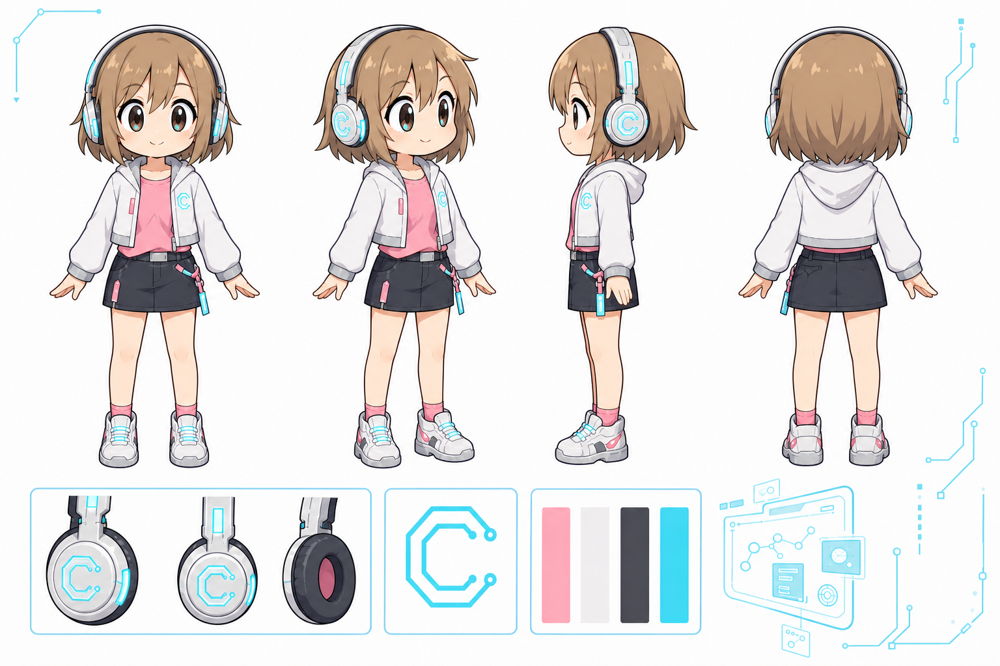

# 🎨 Chasen IP 教程配图

用 Chasen 的 Q 版动漫形象，为教程、工具、流程、概念生成统一风格的解释型配图；也可以出高密度信息图，以及有场景感的 X 长文 / 商单封面。角色参考素材已内置，安装后无需再访问原始 Obsidian 知识库。




## 能做什么

| 特性 | 说明 |
| :--- | :--- |
| 三种模式 | **解释型**白底教程图（默认）· **信息图**高密度对比 · **封面**有场景+艺术字（约 5:2） |
| 角色一致性 | 视觉规范板、设定板、全身立绘与头像随 Skill 分发 |
| 解释型构图 | Chasen 参与操作、演示、排查或解释，一个核心意思一张图 |
| 封面不单调 | 禁止整页白底 / 白 PPT 卡片；要有氛围背景、分层标题、产品道具 |
| 控制文字 | 教程默认无字；封面用用户定稿主/副标题；信息图允许多短标签 |
| 项目内交付 | 结果保存到用户指定目录或当前项目的 `03-Assets/` |

## 安装

```bash
npx skills add Chasen-Liao/Chasen-Skills --skill chasen-ip-tutorial-illustrations --global --yes
```

需要运行环境提供本地图片查看工具，以及支持参考图输入的内置 `image_gen`。安装 Skill 本身不会提供图像生成服务；当前环境缺少工具时，会说明依赖，不自动切换 CLI/API。

## 用法

```text
用 $chasen-ip-tutorial-illustrations 画一张 Chasen 排查 API 报错的配图。
```

也可以直接说：

- 用 Chasen 解释这个 AI Agent 工作流。
- 给这个 Vibe Coding 方法画一张教程配图，不要文字。
- 画一张左右对比信息图，信息密度要大。
- 做一张 X 长文封面 / 商单封面，融入 IP，主标题……

不必提供完整文章，只要主题、对象和动作明确即可。多个核心意思分别出图（信息图 / 封面单板除外）。

封面若生成器只有 16:9：先出 16:9，再裁成约 5:2（如 1280×512），重要文字与人物放在可裁安全带内。

## 内置素材

| 目录 | 内容 |
| :--- | :--- |
| `assets/chasen-ip/01-角色设定/` | 视觉规范板、角色设定板 |
| `assets/chasen-ip/02-头像与立绘/` | 全身立绘、微笑头像 |
| `assets/chasen-ip/03-表情与动作/` | 六格表情动作参考 |
| `assets/chasen-ip/04-内容场景/` | 横版主视觉、四格场景参考 |
| `assets/chasen-ip/05-贴纸与装饰/` | 八格贴纸表情参考 |

素材路径相对于 Skill 目录解析。无需复制到当前项目，也不修改原始素材。

## 输出示例

以下为文件命名示例，不代表已生成的样图：

```text
当前项目/
└── 03-Assets/YYYY-MM-DD-api调试-chasen-ip-illustrations/
    ├── 01-api-debugging.png
    ├── 02-error-fix.png
    └── cover-5x2-final.png
```

已有文件不覆盖，修订使用 `-v2`、`-v3` 后缀。

## 目录

```text
chasen-ip-tutorial-illustrations/
├── SKILL.md
├── README.md
├── agents/openai.yaml
└── assets/chasen-ip/
    ├── 01-角色设定/
    ├── 02-头像与立绘/
    ├── 03-表情与动作/
    ├── 04-内容场景/
    └── 05-贴纸与装饰/
```

## Changelog

- **0.2.0**（2026-11-01）：新增封面模式（约 5:2、场景氛围、艺术字、禁白底 PPT 卡片）与信息图模式；解释型白底仅用于教程配图。
- **0.1.0**：初版解释型 16:9 白底手绘教程配图。
